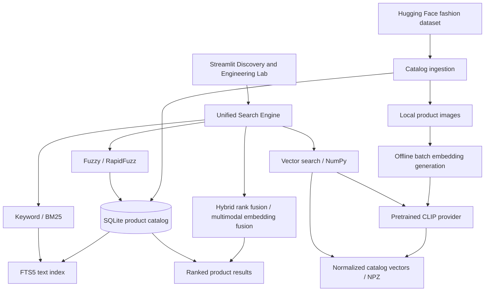

# Fashion Lens

**Multimodal Fashion Search & Discovery Engine**

Fashion Lens is an independent engineering portfolio project inspired by fashion resale marketplaces. It combines keyword, fuzzy, semantic, visual, hybrid and multimodal search in a browser-based product discovery interface. The Engineering Lab lets users compare search modes, inspect results and measure query latency.

**[Live Demo](https://fashionlens.cloud.run/)**

## Features

| Search mode | Description | Example |
| --- | --- | --- |
| Keyword | Lexical retrieval using SQLite FTS5 and BM25 | black handbag |
| Fuzzy | Approximate text matching using RapidFuzz | blak handbg |
| Semantic | Natural-language retrieval against product image embeddings using CLIP | elegant evening bag |
| Visual | Image-to-image similarity search | Upload a handbag photograph |
| Hybrid | Keyword and semantic result lists combined using Reciprocal Rank Fusion (RRF) | black leather handbag |
| Multimodal | Weighted fusion of image and text query embeddings | Upload a bag and search for red leather handbag |

Weighted embedding fusion is experimental. A request such as “the same bag but in red” may return similar bags in other colours.

Visual and multimodal search use CLIP zero-shot fashion relevance detection. Set
`FASHION_LENS_RELEVANCE_MODE` to `OFF`, `SHADOW`, `SOFT` (default), or `ENFORCE`.
SOFT lets users continue after a warning. ENFORCE blocks non-fashion images in
visual and multimodal search. Multimodal users can search with text alone.
If classification fails technically, search continues in every mode.
See [Fashion relevance observability](docs/fashion-relevance-observability.md) for the event schema and Logs Explorer filters.

## Discovery

- Six selectable search modes, with Hybrid selected by default.
- Image uploads, configurable image/text weighting and result counts.
- Category navigation and filters for gender, category, article type and colour. Filters apply before the result limit in all modes.
- Responsive product grid with photos, names, article types and colours.

## Architecture



## Key engineering decisions

| Decision | Rationale |
| --- | --- |
| Pretrained CLIP | Establish a reproducible general-purpose image/text retrieval baseline without training a model from scratch. |
| CPU inference | Avoid GPU infrastructure and paid inference APIs for the initial POC. |
| Offline catalog embedding generation | Avoid recomputing all product embeddings during application startup or search requests. |
| Normalized embeddings | Enable cosine similarity ranking through efficient dot products. |
| Exact brute-force vector search | Keep retrieval simple at 1,000 products. Benchmark approximate indexing when the catalog grows. |
| SQLite and FTS5 | Provide local catalog storage and lexical indexing without a separate database server. |
| Reciprocal Rank Fusion | Combine ranked lists without assuming that BM25 and cosine scores are directly comparable. |
| Reusable search engine | Keep retrieval and ML logic independent of Streamlit, enabling future UI or API migration. |
| Model caching | Reuse the loaded model across searches within an application process. |
| uv and dependency locking | Improve repeatability of Python environments and container builds. |

## Technology stack

| Layer | Technology |
| --- | --- |
| Language | Python 3.12 |
| Dependency management | uv / pyproject.toml / uv.lock |
| UI | Streamlit |
| ML | PyTorch (CPU), Hugging Face Transformers, openai/clip-vit-base-patch32 |
| Image processing | Pillow |
| Dataset ingestion | Hugging Face Datasets |
| Catalog and text search | SQLite, FTS5 / BM25, RapidFuzz |
| Vector search | NumPy NPZ, exact dot-product search over normalized vectors |
| Analysis | pandas / NumPy |
| Version control | Git / GitHub |
| Containerization | Docker |
| Hosting | Google Cloud Run |

## Dataset and model

The catalog uses a seeded sample of 1,000 products from the [Fashion Product Images Small dataset](https://huggingface.co/datasets/ashraq/fashion-product-images-small). Pretrained CLIP generates 512-dimensional catalog image embeddings offline. At search time, CLIP encodes text or uploaded images on CPU and compares the resulting vectors with the catalog embeddings. Changing the embedding model requires regenerating the catalog vectors.

## Getting started

Use Linux or WSL with Git, Python 3.12, uv and internet access for the initial downloads. After cloning, run the remaining commands from the repository root.

```bash
git clone git@github.com:saifcis/fashionlens-vc.git fashionlens
cd fashionlens
uv sync --locked
```

Prepare the SQLite catalog, lexical index, CLIP cache and catalog embeddings. Keep the same shell for the subsequent commands so the app can find the cached model.

```bash
uv run --locked python -m scripts.import_catalog
export HF_HOME="$PWD/deployment/hf-cache"
uv run --locked python -m scripts.load_model
uv run --locked python -m scripts.build_text_index
uv run --locked python -m scripts.build_embeddings
```

Run the search smoke test and launch the local app.

```bash
uv run --locked python -m scripts.test_search_engine
uv run --locked streamlit run streamlit_app.py
```

Open [Discovery](http://localhost:8501/) or the [Engineering Lab](http://localhost:8501/engineering-lab).

## Docker and deployment

Fashion Lens is packaged with Docker and has been deployed publicly on Google Cloud Run. The image installs dependencies from `uv.lock` and bundles the SQLite catalog, product images, embeddings and pretrained CLIP weights for offline CPU inference.

With Docker installed, complete the catalog and model preparation above, then build and run the image from the repository root.

```bash
docker build -t fashionlens:local .
docker run --rm -p 127.0.0.1:8080:8080 fashionlens:local
```

Open [Fashion Lens locally](http://localhost:8080/).

### Cloud Run deployment script

From a clean checkout, prepare the catalog, images, embeddings and Hugging Face cache as shown above. Sign in with `gcloud` and configure Docker authentication for the Artifact Registry host. You need access to pull and push images, update the existing Cloud Run service, read its logs and push Git release tags.

```bash
./deploy-fashion-gcp --dry-run
./deploy-fashion-gcp
```

The script deploys the latest committed `origin/main`. Use `--force` to redeploy an already-serving commit with its existing release image and version, or `--help` for configuration overrides. Run deployments from one checkout/operator at a time. Local logs and release history are stored under `deployment/`.

## Command-line search examples

```bash
uv run --locked python -m scripts.search_text --mode keyword --query "black handbag"
uv run --locked python -m scripts.search_text --mode fuzzy --query "blak handbg"
uv run --locked python -m scripts.search_demo --text "black leather handbag"
uv run --locked python -m scripts.search_demo --image data/images/PRODUCT_ID.jpg
```

Replace `PRODUCT_ID.jpg` with an existing catalog image filename.

## Project structure

```text
fashionlens/
├── app/                 # Search engine and CLIP integration
├── ui/                  # Discovery and Engineering Lab
├── scripts/             # Catalog preparation, demos and smoke test
├── data/                # Generated catalog, images and embeddings
├── deployment/          # Local model cache used by Docker
├── .streamlit/          # Streamlit settings
├── streamlit_app.py
├── pyproject.toml
├── uv.lock
├── Dockerfile
└── .dockerignore
```

## Roadmap

- [x] Catalog ingestion, SQLite indexing and batch embeddings with pretrained CLIP on CPU
- [x] Unified engine for keyword, fuzzy, semantic, visual, hybrid and multimodal search
- [x] Streamlit Discovery with catalog filters and an Engineering Lab
- [x] Locked dependencies with uv
- [x] Docker packaging and public Cloud Run deployment
- [ ] Visual search relevance evaluation using held-out queries and ranking metrics
- [ ] Out-of-distribution image detection
- [ ] Calibrated similarity thresholds
- [ ] Improved no-results handling
- [ ] Alternative ML model evaluation, including SigLIP 2 and fashion-specialized models
- [ ] Automated regression testing and CI/CD
- [ ] Compare exact retrieval with FAISS or another approximate vector index
- [ ] Model and dataset revision pinning, incremental indexing and rollback
- [ ] Controlled fine-tuning experiment with held-out evaluation
- [ ] Production readiness improvements in observability, performance and security

## Scope and limitations

Fashion Lens is a proof of concept for product discovery with a small catalog and low-resolution images. It uses pretrained CLIP without project-specific fine-tuning. Non-fashion images can return irrelevant fashion products, and search relevance still needs formal evaluation. Dataset and image redistribution rights remain unverified. The catalog has no live pricing, inventory or transaction capabilities.

## Acknowledgements

OpenAI CLIP, Hugging Face Datasets, PyTorch, Streamlit, SQLite FTS5, RapidFuzz and uv.
