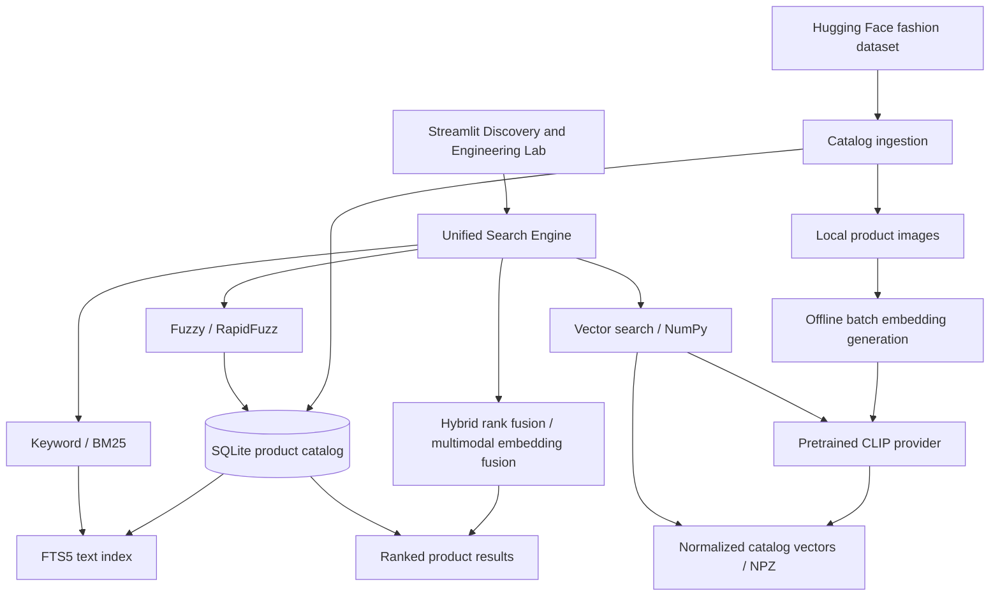

# Fashion Lens

**Multimodal Fashion Search & Discovery Engine**

Fashion Lens is an independent engineering portfolio project exploring modern fashion discovery through keyword search, visual similarity, semantic retrieval and multimodal machine learning.

Inspired by fashion resale marketplaces, the project demonstrates how traditional search techniques and pretrained ML models can work together to create an intelligent product discovery experience.

## Overview

Fashion Lens provides a browser-based product discovery interface and an Engineering Lab for comparing search mechanisms, inspecting retrieved products and measuring execution latency.

The project focuses on practical ML integration, search architecture, relevance, performance, reproducibility and operational efficiency. It uses pretrained models rather than external paid inference APIs.

## Features

| Search mode | Description | Example |
| --- | --- | --- |
| Keyword | Lexical retrieval using SQLite FTS5 and BM25 | black handbag |
| Fuzzy | Approximate text matching using RapidFuzz | blak handbg |
| Semantic | Natural-language retrieval against product image embeddings using CLIP | elegant evening bag |
| Visual | Image-to-image similarity search | Upload a handbag photograph |
| Hybrid | Keyword and semantic result lists combined using Reciprocal Rank Fusion (RRF) | black leather handbag |
| Multimodal | Weighted fusion of image and text query embeddings | Upload a bag and search for red leather handbag |

Weighted embedding fusion is experimental. A request such as “the same bag but in red” may return similar bags in other colours.

## Discovery

- Interactive browser-based product search.
- Six selectable search modes, with Hybrid selected by default.
- Image upload for visual and multimodal queries.
- Configurable image/text weighting and result count.
- Browsable catalog with category navigation and filters for gender, category, article type, and colour.
- Filters apply before the result limit across all search modes.
- Responsive grid with product photographs, names, article types, and colours.
- Marketplace-inspired presentation, with Fashion Lens branding.

## Architecture



## Key engineering decisions

| Decision | Rationale |
| --- | --- |
| Pretrained CLIP | Establish a reproducible general-purpose image/text retrieval baseline without training a model from scratch. |
| CPU inference | Avoid GPU infrastructure and paid inference APIs for the initial POC. |
| Offline catalog embedding generation | Avoid recomputing all product embeddings during application startup or search requests. |
| Normalized embeddings | Enable cosine similarity ranking through efficient dot products. |
| Exact brute-force vector search | Keep retrieval simple at 1,000 products. Benchmark approximate indexing when the catalog grows. |
| SQLite and FTS5 | Provide local catalog storage and lexical indexing without a separate database server. |
| Reciprocal Rank Fusion | Combine ranked lists without assuming that BM25 and cosine scores are directly comparable. |
| Reusable search engine | Keep retrieval and ML logic independent of Streamlit, enabling future UI or API migration. |
| Model caching | Reuse the loaded model across searches within an application process. |
| uv and dependency locking | Improve repeatability of Python environments and future container builds. |

## Technology stack

| Layer | Technology |
| --- | --- |
| Language | Python 3.12 |
| Dependency management | uv / pyproject.toml / uv.lock |
| UI | Streamlit |
| ML runtime | PyTorch (CPU) |
| Model integration | Hugging Face Transformers |
| Baseline model | openai/clip-vit-base-patch32 |
| Image processing | Pillow |
| Dataset ingestion | Hugging Face Datasets |
| Product storage | SQLite |
| Lexical retrieval | SQLite FTS5 / BM25 |
| Fuzzy matching | RapidFuzz |
| Vector storage | NumPy NPZ |
| Vector retrieval | Exact dot-product search over normalized vectors |
| Analysis | pandas / NumPy |
| Version control | Git / GitHub |
| Planned hosting | Docker / Google Cloud Run |

## Dataset and baseline measurements

The initial import uses a seeded sample of 1,000 products. The figures below are historical local measurements. [Fashion Product Images Small dataset](https://huggingface.co/datasets/ashraq/fashion-product-images-small)

| Metric | Initial local result |
| --- | --- |
| Imported products | 1,000 |
| Product images | 1,000 |
| SQLite catalog size before text indexing | 132 KB |
| Initial catalog and image storage | 4.1 MB |
| CLIP model parameters | 151,277,313 |
| Embedding dimensions | 512 |
| Model weights file | Approximately 605 MB |
| Peak process RAM during initial model loading | Approximately 1.19 GiB |
| Initial measured model loading time | 70.59 s (includes download work) |
| Initial total process elapsed time | 145.10 s |
| Raw float32 vector matrix size (1,000 × 512) | Approximately 1.95 MiB (calculated) |

Measurements were obtained locally on WSL Ubuntu 24.04 using CPU execution. Initial loading measurements include download and caching overhead and describe first-time model preparation. Cloud resource requirements and formal search benchmarks remain to be validated.

The source dataset contains low-resolution product images. Public deployment depends on confirming the applicable dataset and image redistribution rights.

## Getting started

### Prerequisites

- Linux or WSL Ubuntu (the initial target environment)
- Python 3.12
- Git
- uv
- Internet access for the initial dependency, dataset and model downloads
- Sufficient RAM and disk space for CPU inference and local model caching

### 1. Clone the repository

Clone the repository and run the remaining commands from its root.

```bash
git clone git@github.com:saifcis/fashionlens-vc.git fashionlens
cd fashionlens
```

### 2. Install dependencies

```bash
uv sync --locked
```

The Linux configuration uses the CPU-only PyTorch package index. The lockfile pins Python dependencies. Model and dataset revision pinning is on the roadmap.

### 3. Prepare the catalog and model

```bash
uv run --locked python -m scripts.import_catalog
uv run --locked python -m scripts.load_model
uv run --locked python -m scripts.build_text_index
uv run --locked python -m scripts.build_embeddings
```

These commands import the product catalog, download/cache CLIP, build the lexical index and generate catalog image embeddings. The model is downloaded during preparation because the search provider uses locally cached weights at runtime.

### 4. Run the search smoke test

```bash
uv run --locked python -m scripts.test_search_engine
```

### 5. Launch Fashion Lens

```bash
uv run --locked streamlit run streamlit_app.py
```

Open [Discovery](http://localhost:8501/) or go directly to [Engineering Lab](http://localhost:8501/engineering-lab).

## Command-line search examples

```bash
uv run --locked python -m scripts.search_text --mode keyword --query "black handbag"
uv run --locked python -m scripts.search_text --mode fuzzy --query "blak handbg"
uv run --locked python -m scripts.search_demo --text "black leather handbag"
```

For visual search, replace `PRODUCT_ID.jpg` with an existing local JPEG filename.

```bash
uv run --locked python -m scripts.search_demo --image data/images/PRODUCT_ID.jpg
```

## Project structure

```text
fashionlens/
├── app/
│   ├── embeddings/
│   │   └── clip_provider.py
│   └── search/
│       ├── catalog.py
│       ├── engine.py
│       ├── keyword_search.py
│       ├── fuzzy_search.py
│       ├── vector_search.py
│       └── hybrid_search.py
├── scripts/
│   ├── explore_dataset.py
│   ├── import_catalog.py
│   ├── load_model.py
│   ├── generate_embedding.py
│   ├── compare_images.py
│   ├── build_embeddings.py
│   ├── build_text_index.py
│   ├── search_demo.py
│   ├── search_text.py
│   └── test_search_engine.py
├── ui/
│   ├── components.py
│   ├── discovery.py
│   ├── engineering_lab.py
│   └── styles.css
├── data/                     # Local generated data
│   ├── catalog.db
│   ├── images/
│   └── embeddings/
├── .streamlit/
│   └── config.toml
├── streamlit_app.py
├── pyproject.toml
├── uv.lock
└── README.md
```

## ML lifecycle and evaluation

Fashion Lens currently uses a frozen pretrained CLIP model. Catalog indexing uses the model as-is to generate embeddings.

Catalog images are encoded offline. At search time, text or uploaded images are encoded into the same embedding space and compared against existing catalog vectors. Changing the embedding model requires regenerating compatible catalog embeddings.

Future evaluation will compare baseline CLIP against Google SigLIP 2 and fashion-specialized models using held-out relevance judgments, ranking metrics, latency, memory consumption and indexing throughput.

## Roadmap

- [x] Local dataset ingestion and SQLite catalog
- [x] CPU-based pretrained CLIP integration
- [x] Batch image embedding generation and persistence
- [x] Keyword, fuzzy, semantic and visual search
- [x] Hybrid and multimodal search
- [x] Unified search engine
- [x] Streamlit Discovery and Engineering Lab
- [x] Use uv and a locked dependency environment
- [x] Marketplace-inspired Discovery UI, category navigation, and catalog filters
- [ ] Automated regression tests and CI quality gates
- [ ] Docker packaging and public Cloud Run deployment
- [ ] Compare exact retrieval with FAISS or another approximate vector index
- [ ] Model benchmarking: CLIP, SigLIP 2 and fashion-specialized models
- [ ] Formal relevance evaluation: Precision@K, Recall@K and NDCG@K
- [ ] Model and dataset revision pinning, incremental indexing and rollback
- [ ] Controlled fine-tuning experiment with held-out evaluation
- [ ] Production readiness: observability, concurrency, security and cost controls

## Scope and limitations

Fashion Lens is a proof of concept for product discovery. The initial catalog lacks live pricing, inventory and transaction capabilities. Search relevance has not been formally validated, the lexical and vector indexes are initially snapshots, and the existing model is not fine-tuned on this catalog. Deployment cost, concurrent-user performance and image redistribution rights require validation before public release.

## Acknowledgements

- OpenAI CLIP
- Hugging Face Datasets
- PyTorch
- Streamlit
- SQLite FTS5
- RapidFuzz
- uv

Fashion Lens is an independent engineering portfolio project with no affiliation with any website
